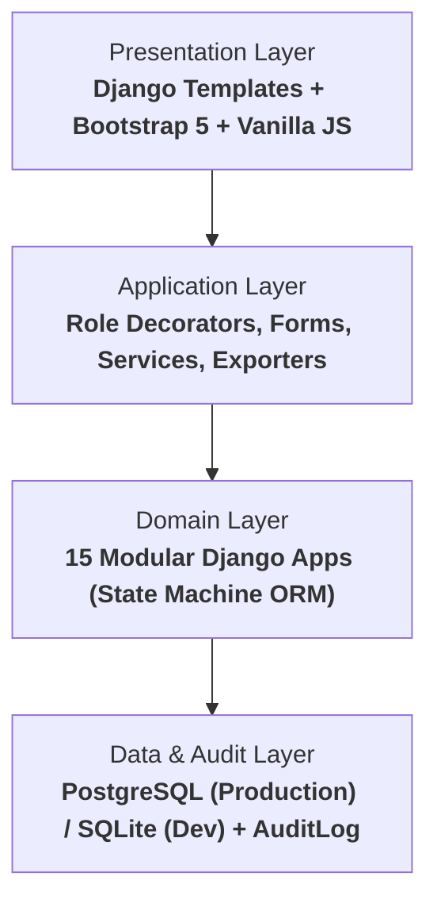

# RedLink Architecture & Technical Design

## 1. Architectural Philosophy
RedLink is engineered as a monolithic, modular Django application prioritizing data integrity, strict auditability, deterministic state machines, and concurrency safety.

Microservices, Kafka, and separate frontend frameworks (e.g. React/Node) were explicitly avoided to eliminate network partitioning hazards, eventual consistency gaps, and unnecessary operational complexity in mission-critical blood transfusion workflows.

## 2. Component Hierarchy

## 3. Separation of Responsibilities (15 Django Apps)
1. **core**: Organization identity, blood bank settings, regulatory parameters, and global error handling.
2. **audit**: Global thread-local audit middleware, immutable event log for every state transition and user action.
3. **accounts**: Role-based access control (RBAC), 9-role user profiles, and personalized dashboard dispatching.
4. **hospitals**: Affiliated institutions, hospital contacts, verification lifecycle, and requisition permissions.
5. **patients**: Recipient identity, medical records, hospital MRN tracking, and transfusion history.
6. **donors**: Voluntary donor registry, demographic records, contact info, and deferral statuses.
7. **appointments**: Scheduling, calendar slot validation, check-in automation, and reminder triggers.
8. **camps**: Community blood donation drives, venue management, and mobile phlebotomy logistics.
9. **donations**: Phlebotomy collection events, volume accounting, and adverse donor reaction tracking.
10. **laboratory**: Serological test entry, TTI screening gates (HIV, HBV, HCV, Syphilis, Malaria), and medical officer sign-off.
11. **blood_components**: Fractionation and separation into PRBC, FFP, Platelets, and Cryoprecipitate.
12. **inventory**: Unit-level tracking, storage hierarchy (Area &rarr; Device &rarr; Position), and cold-chain logging.
13. **requests_app**: Clinical requisitions, atomic reservations (`select_for_update`), issue and return triage.
14. **notifications**: In-app alert queue for cold-chain alarms, expiration warnings, and STAT requisitions.
15. **reports**: Reporting and regulatory audit export suite (CSV and tabular views).

## 4. Concurrency & Integrity Model
- **Atomic Reservation Workflow:** When reserving a unit, RedLink wraps the operation inside `transaction.atomic()` and locks the candidate row using `select_for_update()`. If two users request the same unit simultaneously, the database serializes access, eliminating double allocations.
- **Quarantine Safety Gate:** Quarantined, non-screened, or expired units are strictly filtered out of the issuable pool at the ORM query level and validated on the model layer (`is_issuable`).
- **Audit Logging:** Every database write is automatically intercepted by the audit middleware and recorded with the authenticated user, client IP address, timestamp, and field-level delta changes.
