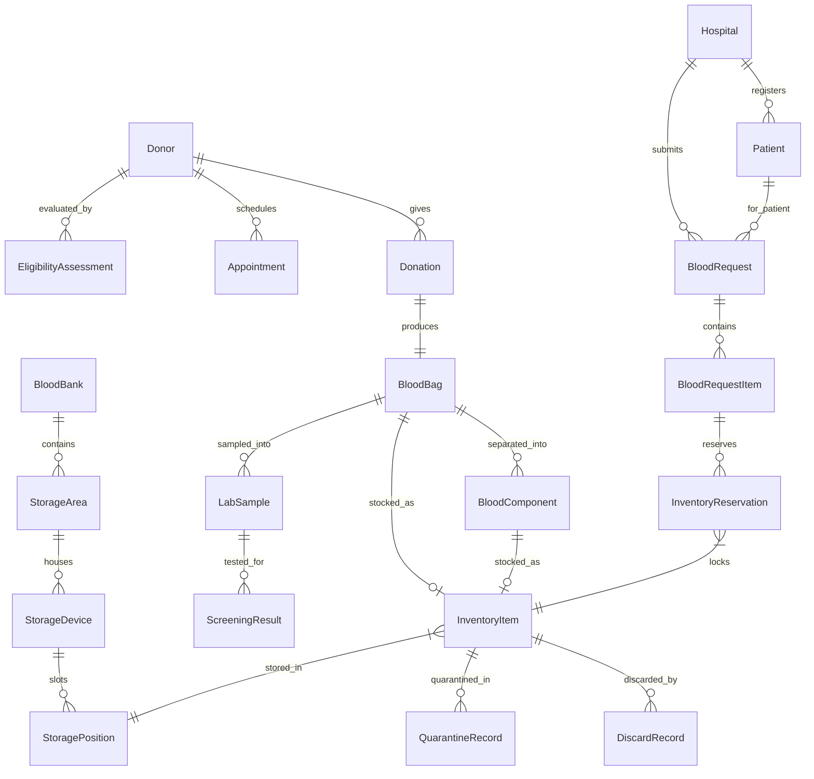

# RedLink Database Specification & Entity Model

## 1. Storage Engine
- **Local Development:** SQLite 3 with full foreign key constraints enabled (`PRAGMA foreign_keys = ON`).
- **Production:** PostgreSQL 14+ with connection pooling, index scans, and JSONB payload support.

## 2. Key Entity Relationships

### Cardinality Summary
- **BloodBank (1:N) StorageArea (1:N) StorageDevice (1:N) StoragePosition**
- **Donor (1:N) EligibilityAssessment**
- **Donor (1:N) Donation (1:1) BloodBag (1:N) LabSample (1:N) ScreeningResult**
- **BloodBag (1:N) BloodComponent**
- **BloodBag / BloodComponent (1:1) InventoryItem**
- **InventoryItem (1:N) QuarantineRecord**
- **Hospital (1:N) BloodRequest (1:N) BloodRequestItem (1:N) InventoryReservation (N:1) InventoryItem**
- **BloodRequest (1:N) BloodIssue (1:1) BloodReturn**
- **InventoryItem (1:N) DiscardRecord**

## 3. Database Indexes
- **InventoryItem:** Indexed on `inventory_id`, `(status, component_type, blood_group)`, and `(expiry_date, status)`.
- **BloodBag:** Indexed on `bag_id`, `(blood_group, status)`, and `expiry_date`.
- **BloodRequest:** Indexed on `request_id`, `(status, priority)`, and `(hospital, created_at)`.
- **AuditLog:** Indexed on `(model_name, object_id)` and `(action, timestamp)`.
- **Donor:** Indexed on `donor_id`, `phone`, and `blood_group`.
- **Donation:** Indexed on `donation_id`, `(donor, donation_date)`, and `status`.

## 4. Identifier Formatting Standard
All entities use zero-padded, prefixed unique identifiers for full clinical and regulatory traceability:

| Entity | Prefix Pattern | Example |
|---|---|---|
| Donor | `DNR-NNNNN` | `DNR-00042` |
| Blood Bag | `BB-NNNNN` | `BB-00123` |
| Lab Sample | `SMP-NNNNN` | `SMP-00456` |
| Component | `CMPNT-NNNNN` | `CMPNT-00789` |
| Inventory | `INV-NNNNN` | `INV-00234` |
| Request | `REQ-NNNNN` | `REQ-00056` |
| Reservation | `RSV-NNNNN` | `RSV-00012` |
| Issue | `ISS-NNNNN` | `ISS-00034` |
| Return | `RET-NNNNN` | `RET-00005` |
| Discard | `DIS-NNNNN` | `DIS-00007` |
| Quarantine | `QRN-NNNNN` | `QRN-00011` |
| Camp | `CMP-NNNNN` | `CMP-00003` |
| Appointment | `APT-NNNNN` | `APT-00017` |
| Patient | `PAT-NNNNN` | `PAT-00099` |
